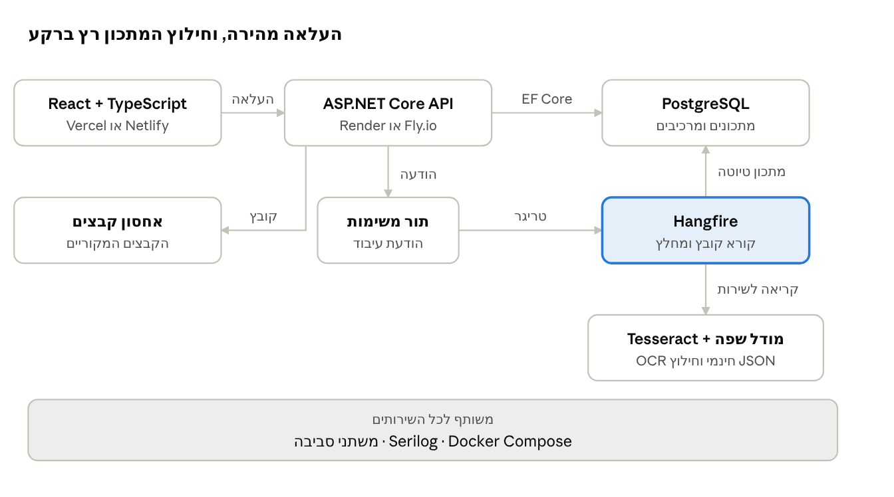

# אפיון פרויקט ניהול מתכונים (Full Stack)

Oct 31, 2026 · @Someone

## רקע ומטרות

הפרויקט (שם עבודה: RecipeVault) הוא מערכת Full Stack שמאחדת מתכונים מפוזרים, בקבצים מכל סוג, למאגר אחד שאפשר לחפש בו ולבשל ממנו.

**הבעיה:** מתכונים נשמרים כצילומי מסך, תמונות של דפים, קובצי PDF, מסמכי Word והודעות, ואי אפשר לחפש בהם, לסנן אותם או לתכנן מהם שבוע.

**הפתרון:** מעלים קובץ, והמערכת מחלצת ממנו מתכון מובנה (שם, מרכיבים, כמויות, שלבים, זמנים). אחרי זה אפשר לחפש לפי תגיות ולפי מה שיש בבית, להתאים כמויות ולהפיק רשימת קניות מאוחדת.

**מה הפרויקט מוכיח בראיון עבודה:**

- בנייה של מערכת מלאה: React ו-API ב-C#, מהקוד ועד הפריסה, על שירותים חינמיים וברי-החלפה, עם הרחבה אפשרית ל-Azure
- עבודה עם קבצים, אחסון בענן ועיבוד אסינכרוני
- שילוב AI/OCR בצורה מבוקרת, עם אימות ותיקון ידני של התוצאה
- פתרון בעיה אלגוריתמית אמיתית: איחוד מרכיבים וכמויות
- איכות הנדסית: בדיקות, CI/CD, אבטחה ותיעוד

## משתמשים ותרחישי שימוש

המשתמש המרכזי הוא אדם שמבשל באופן קבוע ויש לו אוסף מתכונים גדול ומבולגן, בבית או לצורך אירוח. כל משתמש רואה רק את המתכונים שלו.

| # | תרחיש | התוצאה |
|---|---|---|
| 1 | מעלה צילום של מתכון מכתב יד או מ-PDF | נוצר מתכון מובנה, והמשתמש מאשר או מתקן |
| 2 | מחפש "משהו מהיר עם עוף ואורז" | רשימת מתכונים לפי אחוז התאמה |
| 3 | מסמן מרכיבים שיש במקרר | מתכונים שאפשר להכין, וכמה מרכיבים חסרים בכל אחד |
| 4 | בוחר 4 מתכונים לשבת ומגדיר 12 סועדים | כמויות מותאמות ורשימת קניות אחת |
| 5 | מסנן לפי בשרי, חלבי או פרווה, זמן הכנה ומועדפים | רשימה מסוננת, ואפשר לשמור את הסינון |

## פיצ'רים לפי שלבים

ה-MVP מכסה את הליבה: הרשמה, הוספת מתכון בכתיבה ידנית או בהעלאת קובץ, חילוץ מתכון, תיקון ידני וחיפוש. כל מה שמעבר לזה נבנה בשלבים, כדי שבכל שלב יהיה מוצר עובד שאפשר להציג.

| שלב | פיצ'ר | למה הוא חשוב |
|---|---|---|
| MVP | הרשמה והתחברות (ASP.NET Core Identity) | כל משתמש רואה רק את המתכונים שלו |
| MVP | הוספת מתכון בכתיבה ידנית: שם, תיאור, קטגוריה, כשרות, זמנים, מנות, קושי, מצרכים ושלבים. נשמר ישר כמאושר, בלי חילוץ | הדרך הפשוטה להכניס מתכון בלי קובץ, וכך הספר שימושי גם כשאין מה להעלות |
| MVP | העלאת קבצים: תמונה, PDF, Word, טקסט | הרעיון המרכזי של הפרויקט |
| MVP | חילוץ אוטומטי של מתכון, מסך אישור ותיקון | מראה שימוש אחראי ב-AI |
| MVP | רשימת מתכונים, תצוגת מתכון, שמירת הקובץ המקורי לצד המתכון | בסיס המערכת |
| MVP | תגיות וסינון: בשרי/חלבי/פרווה, זמן, מועדפים | החלק של "מאגר עם חיפוש חכם" |
| MVP | חיפוש טקסט חופשי | שימושיות יומיומית |
| שלב 2 | חיפוש לפי מרכיבים שיש בבית, עם אחוז התאמה | פיצ'ר מבדל |
| שלב 2 | התאמת כמויות למספר סועדים | לוגיקה עסקית שאפשר לבדוק |
| שלב 2 | רשימת קניות מאוחדת מכמה מתכונים | האתגר האלגוריתמי המרכזי |
| שלב 2 | מצב בישול: סימון מרכיבים ושלבים, ואחר כך שלב אחד גדול בכל מסך עם טיימרים, בלי כיבוי מסך | חוויית משתמש מוקפדת |
| שלב 3 | תכנון תפריט שבועי | הרחבת השימוש |
| שלב 3 | שיתוף מתכון בקישור | הצגת הפרויקט בראיון בלי הרשמה |
| שלב 3 | ייצוא כ-PDF | עבודה עם מסמכים |
| שלב 3 | יומן הכנות: הערות, דירוג, תמונת תוצאה | העמקה עתידית |

## ארכיטקטורה

הארכיטקטורה מפרידה בין הבקשה המהירה של המשתמש לבין העיבוד האיטי: ה-API מחזיר תשובה מיד, והחילוץ רץ ברקע.



ארכיטקטורה · 7 רכיבים וזרימת העלאה אחת

הלקוח מעלה קובץ ל-API, שמאחסן אותו באחסון קבצים ושולח משימה לתור. עובד ברקע (Hangfire) קוראת את הקובץ, מחלצת ממנו את המתכון ושומרת אותו כטיוטה, והמשתמש מאשר אותה בלקוח לפני שהיא נשמרת כמאושרת.

## מודל נתונים

המודל מפריד בין המרכיב כפי שנכתב במתכון לבין המרכיב המנורמל ("בצל"), וההפרדה הזאת מאפשרת חיפוש וחישוב רשימת קניות.

| טבלה | שדות עיקריים | הערה |
|---|---|---|
| User | Id, Email, CreatedAt | נוצר בהרשמה |
| Recipe | Id, UserId, Title, Servings, PrepMinutes, CookMinutes, Kashrut (בשרי/חלבי/פרווה), IsFavorite, Difficulty (קל/בינוני/מורכב), SourceName, ChefTip, CategoryId, Origin (ידני/מקובץ), Status | Status: ממתין לחילוץ, ממתין לאישור, מאושר. מתכון שנכתב ידנית נשמר ישר כמאושר, בלי חילוץ ובלי שלב אישור, ואין לו קובץ מקור |
| RecipeIngredient | Id, RecipeId, RawText, IngredientId, Quantity, UnitId | RawText נשמר תמיד כפי שנכתב במקור |
| Ingredient | Id, Name, Aliases | שם מנורמל, כגון "בצל", עם כינויים כמו "בצלים" |
| Unit | Id, Name, ToBaseFactor | המרה ליחידת בסיס (גרם, מ"ל) |
| RecipeStep | Id, RecipeId, Order, Text | שלבי הכנה |
| RecipeFile | Id, RecipeId, FilePath, ContentType, OriginalName | הקובץ המקורי באחסון הקבצים (קיים רק במתכון שיובא מקובץ) |
| Tag, RecipeTag | Id, Name; RecipeId, TagId | תגיות חופשיות |
| ExtractionJob | Id, RecipeFileId, State, ErrorMessage, RawResult | מעקב אחרי העיבוד האסינכרוני |

כל מתכון שייך למשתמש דרך UserId, וכל שאילתה על מתכונים וקבצים מסוננת לפיו. טבלאות Ingredient ו-Unit משותפות לכל המשתמשים.

קטגוריה (עיקריות, סלטים, מרקים, מאפים, קינוחים, ארוחות בוקר) נשמרת בטבלת Category (Id, UserId, Name), ולכל מתכון קטגוריה אחת. המונים בתפריט הצד מחושבים בשאילתה ולא נשמרים.

## טכנולוגיות מומלצות

המלצה: React עם TypeScript בצד הלקוח, ASP.NET Core ב-C# בצד השרת, ושירותים חינמיים להרצה, אחסון וחילוץ מתכונים. כל שירות חיצוני מוסתר מאחורי ממשק, ולכן אפשר להרחיב אחר כך ל-Azure בלי לשכתב את האפליקציה (ראו הסעיף על ההרחבה). הבחירות האלה מתאימות לניסיון שלך, והן סטנדרט נפוץ בחברות שמחפשות מפתחי Full Stack על סטאק של Microsoft.

| שכבה | בחירה | נימוק | אלטרנטיבה |
|---|---|---|---|
| לקוח | React, TypeScript, Vite | סטנדרט בשוק, טיפוסים בטוחים, בנייה מהירה | Next.js, אם נדרש SSR |
| ניהול מצב שרת | TanStack Query | מטמון, ניסיונות חוזרים וטעינה בלי קוד חוזר | Redux Toolkit Query |
| עיצוב | Tailwind CSS עם רכיבים משלנו, או MUI עם עיצוב מותאם | שליטה מלאה בצבעים ובצורות כדי להתאים לסגנון בסרטון, ו-RTL דרך תכונות לוגיות | Chakra UI |
| API | ASP.NET Core Web API על .NET LTS עדכני, Minimal APIs או Controllers | הניסיון שלך, ביצועים, תיעוד Swagger/OpenAPI | Azure Functions, ל-API קטן |
| גישה לנתונים | Entity Framework Core | מיגרציות, LINQ, בדיקות נוחות | Dapper, לשאילתות כבדות |
| מסד נתונים | PostgreSQL (Neon או Supabase בחינם), ובפיתוח SQLite | יחסי, מתאים למודל, תמיכה בחיפוש טקסט מלא | Azure SQL Database, בהרחבה |
| אחסון קבצים | תיקייה מקומית בפיתוח, ו-Cloudflare R2 בענן | קבצים מכל סוג, גישה דרך קישור זמני | Azure Blob Storage, בהרחבה |
| עיבוד ברקע | Hangfire בתוך ה-API | חילוץ מתכון לוקח זמן ולא חוסם את ה-API | Azure Functions עם Storage Queue, בהרחבה |
| חילוץ מקבצים | Tesseract (OCR חינמי), ואחריו מודל שפה במסלול חינמי (Gemini) או מקומי (Ollama) שממיר טקסט למבנה JSON | ללא עלות. הדיוק נמוך יותר, במיוחד בכתב יד, ולכן מסך האישור הוא חלק מהותי מהזרימה | Azure Document Intelligence ומודל שפה ב-Azure, בהרחבה |
| אימות | ASP.NET Core Identity | מערכת משתמשים מוכנה ב-ASP.NET Core, בלי שירות חיצוני | ASP.NET Core Identity |
| הרצה | Vercel או Netlify ללקוח, Render או Fly.io ל-API (מסלולים חינמיים) | פריסה פשוטה מ-GitHub | Azure Static Web Apps ו-App Service, בהרחבה |
| סודות וניטור | משתני סביבה וסודות בשירות האירוח וב-GitHub, ולוגים עם Serilog | אין סיסמאות בקוד, ויש מעקב אחרי שגיאות |  |
| תשתית כקוד | Bicep, אופציונלי ובהרחבה ל-Azure בלבד | סביבה שאפשר ליצור מחדש בפקודה אחת | Terraform |
| CI/CD | GitHub Actions | בנייה, בדיקות ופריסה אוטומטיות | Azure DevOps |
| בדיקות | xUnit, Testcontainers, Vitest, React Testing Library, Playwright | יחידה, אינטגרציה וקצה לקצה |  |

המסלול הראשי בנוי על שירותים חינמיים ולכן אין עלות קבועה. מגבלות המסלולים החינמיים משתנות, ולכן כדאי לבדוק אותן לפני הפריסה. אם עוברים ל-Azure, צריך להגדיר התראת תקציב.

## הכנה לגרסה שולחנית עתידית

גרסה מקומית, שעובדת בלי אינטרנט עם הנתונים במחשב, לא נבנית בשלב א. שלב א נכתב כך שאפשר יהיה להוסיף אותה אחר כך בלי לשכתב את הלוגיקה, וזה עולה כ-8 שעות נוספות בהקמה. הגרסה המקומית עצמה (כ-35 עד 50 שעות) נשארת כשלב עתידי.

כל שירות חיצוני מוסתר מאחורי ממשק ב-C#, והמימוש נבחר בהגדרות. הטבלה מציגה את המימוש הראשי (חינמי), את ההרחבה ל-Azure ואת הגרסה המקומית העתידית:

| ממשק | מימוש עכשיו (חינמי) והרחבה ל-Azure | מימוש עתידי (מקומי) |
|---|---|---|
| IFileStore | תיקייה מקומית ו-Cloudflare R2. הרחבה: Blob Storage | תיקייה במחשב |
| IRecipeExtractor | Tesseract ומודל שפה חינמי. הרחבה: Document Intelligence ומודל שפה ב-Azure | OCR מקומי, או שירות בענן כשיש אינטרנט |
| IJobQueue | Hangfire בתוך ה-API. הרחבה: Storage Queue ו-Azure Functions | תור בתוך האפליקציה (BackgroundService) |
| IRecipeSearch | חיפוש טקסט מלא ב-PostgreSQL. הרחבה: Azure SQL | SQLite FTS5 |
| ICurrentUser | ASP.NET Core Identity. הרחבה: Microsoft Entra External ID | משתמש מקומי יחיד |

כללים לכתיבת הקוד כבר מהיום הראשון:

- הלוגיקה העסקית (נרמול מרכיבים, התאמת כמויות, רשימת קניות) יושבת בפרויקט נפרד, בלי שום הפניה לחבילות של שירותי ענן
- חבילות של שירותי ענן (כמו Azure) מופיעות רק בפרויקט התשתית, והחיבור למימוש נעשה ב-Dependency Injection
- המודל ב-EF Core נכתב בלי תכונות ייחודיות ל-SQL Server, כדי שאפשר יהיה להחליף בין PostgreSQL, SQLite ו-Azure SQL
- הלקוח ב-React פונה ל-API לפי כתובת בסיס שנקבעת בהגדרות, ולא מקבל קישורי אחסון ישירות
- אותן בדיקות יחידה רצות על כל מימוש של כל ממשק

## אתגרים טכניים מרכזיים

שלושה אתגרים הופכים את הפרויקט ממערכת CRUD לפרויקט שיש מה לספר עליו בראיון.

**1. איחוד מרכיבים ורשימת קניות**

"2 בצלים", "בצל גדול" ו-"300 גרם בצל" הם אותו מרכיב ביחידות שונות. הפתרון: נרמול שם המרכיב לפי טבלת כינויים, המרת יחידות ליחידת בסיס לפי טבלת המרה, וקיבוץ לפי מרכיב. מרכיב שאי אפשר להמיר (למשל "מעט מלח") מוצג בנפרד ולא מחושב. זו לוגיקה טהורה, ולכן קל לכסות אותה בבדיקות יחידה.

**2. חילוץ מתכון מקובץ**

החילוץ אסינכרוני: ה-API שומר את הקובץ ומחזיר מיד תשובה, ועיבוד ברקע מריץ OCR ואחריו מודל שפה שמחזיר JSON לפי סכמה קבועה. התוצאה נבדקת מול הסכמה, ואם הבדיקה נכשלת, המתכון נשאר במצב "ממתין לתיקון ידני". המשתמש תמיד מאשר לפני שמירה, כי חילוץ אוטומטי טועה לפעמים.

**3. חיפוש לפי מה שיש בבית**

לכל מתכון מחושב אחוז ההתאמה: מספר המרכיבים שיש למשתמש חלקי מספר המרכיבים הנדרשים, בלי מרכיבי יסוד כמו מלח ומים. מתחילים בשאילתת SQL עם אינדקסים, ועוברים למנוע חיפוש ייעודי רק אם מתברר שזה לא מספיק מהיר או מדויק.

## בדיקות, CI/CD ואבטחה

המטרה היא שכל שינוי נבדק ונפרס אוטומטית, ושמידע של משתמש אחד לא נחשף לאחר.

- **בדיקות יחידה (xUnit):** נרמול מרכיבים, המרת יחידות, התאמת כמויות, רשימת קניות ואחוז התאמה
- **בדיקות אינטגרציה (Testcontainers):** ה-API מול מסד נתונים אמיתי, כולל בדיקה שמשתמש לא יכול לקרוא מתכון של משתמש אחר
- **בדיקות לקוח (Vitest ו-React Testing Library):** טופס אישור מתכון, סינון וחיפוש
- **קצה לקצה (Playwright):** הוספת מתכון ידנית ומציאתו בחיפוש, והעלאת קובץ ואישור המתכון
- **CI/CD (GitHub Actions):** בנייה, בדיקות ופריסה אוטומטית לסביבת בדיקה ואחריה לסביבת ייצור
- **אבטחה:** אימות קובץ לפי סוג וגודל, קישורי הורדה זמניים, סודות במשתני סביבה ולא בקוד, והפרדת הרשאות בין שירותים, ו-CORS מצומצם

## תנאי פתיחה והתקנות

לפני שכותבים שורת קוד צריך כמה חשבונות וכלים, וההכנה כולה אמורה לקחת בערך שעה. מנוי Azure נדרש רק להרחבה.

**חשבונות**

- ☐ GitHub, עם שם משתמש מקצועי (שם יושב הקוד וגם ה-CI/CD)
- ☐ חשבונות חינמיים לאירוח: Vercel או Netlify, Render או Fly.io, Neon או Supabase, ו-Cloudflare R2
- ☐ מפתח חינמי למודל שפה (Gemini), או Ollama מותקן במחשב
- ☐ להרחבה בלבד: מנוי Azure פעיל, התראת תקציב, ובדיקה מראש אם נדרש אישור למשאב של מודל שפה
- ☐ Figma, חשבון חינמי, לעיצוב המסכים

**כלים במחשב**

- ☐ Git
- ☐ VS Code עם התוספות: C# Dev Kit, Docker, ESLint ו-Prettier
- ☐ .NET SDK, גרסת LTS העדכנית
- ☐ Node.js, גרסת LTS
- ☐ Docker Desktop (ב-Windows כדאי להפעיל WSL 2)
- ☐ Azure CLI ו-Bicep, להרחבה בלבד (לא חובה בהתחלה)
- ☐ Tesseract, לזיהוי טקסט מקומי (אפשר גם בתוך קונטיינר Docker)

**דרישות חומרה:** מומלץ זיכרון של 16 GB. מסד הנתונים בקונטיינר דורש זיכרון משלו, ו-Docker, VS Code והדפדפן רצים במקביל.

**בדיקה שהכול מותקן:** מריצים את הפקודות הבאות, וכל אחת צריכה להחזיר מספר גרסה.

```
git --version
dotnet --version
node --version
docker --version
az --version
```

**מבנה הריפוזיטורי המוצע:**

```
recipe-vault/
  api/
    RecipeVault.sln
    src/
      RecipeVault.Api/             ASP.NET Core Web API
      RecipeVault.Core/            לוגיקה עסקית, בלי הפניות לחבילות ענן
      RecipeVault.Infrastructure/  EF Core, אחסון קבצים, תור, חילוץ
    tests/
      RecipeVault.Core.Tests/              בדיקות יחידה
      RecipeVault.Api.IntegrationTests/    בדיקות אינטגרציה
    Dockerfile
  client/                          React + TypeScript + Vite
    Dockerfile
  docs/
    design-reference/              צילומי מסך מהסרטון
  docker-compose.yml
  CLAUDE.md
  README.md
```

## UI/UX: מה זה ואיך משתמשים בו בפרויקט

UI ו-UX הם שני חלקים של עיצוב מוצר: UI הוא איך המערכת נראית, ו-UX הוא איך זה מרגיש להשתמש בה.

**UI (ממשק משתמש)** הוא מה שרואים על המסך: כפתורים, צבעים, גופנים, סידור הרכיבים ואייקונים.

**UX (חוויית משתמש)** היא כמה קל להשיג מטרה: כמה צעדים צריך, אם ברור מה לעשות, מה קורה כשטועים, וכמה זה מהיר.

דוגמה מהמטבח: UI הוא איך נראים הארונות והצבעים, ו-UX הוא אם הסכין והקרש נמצאים ביד כשצריך אותם. מטבח יפה שאי אפשר לבשל בו הוא UI טוב עם UX גרוע.

חשיבות לראיון: מראיינים מחפשים מפתחת Full Stack שחושבת גם על המשתמש, ופרויקט עם עיצוב מוקפד ומסך אישור חכם מבדיל אותך מעוד פרויקט CRUD.

**תהליך העיצוב בפרויקט (כ-10 עד 15 שעות לעיצוב, ועוד כ-15 עד 25 לבנייה רספונסיבית, בהערכה גסה):**

1. **זרימות:** מגדירים את המסלולים המרכזיים, למשל מעלים קובץ, מאשרים ומוצאים את המתכון
1. **שרטוטים (Wireframes):** ציורים בשחור-לבן של כל מסך, בלי צבעים, כדי להחליט מה נמצא איפה
1. **עיצוב ויזואלי:** צבעים, גופנים ורכיבים חוזרים (כפתור, כרטיס מתכון, תגית), ב-Figma או במסמך עיצוב
1. **בנייה ובדיקה:** מממשים ב-React, ומראים לשניים או שלושה אנשים לראות איפה הם נתקעים

**החלטות UX מרכזיות בפרויקט:**

| החלטה | הסיבה |
|---|---|
| עברית ו-RTL מהיום הראשון | כל הרכיבים נבנים בכיוון הנכון, ולא מתקנים בסוף |
| רספונסיבי: מטלפון ועד מחשב | העיצוב בסרטון הוא למחשב, ומתכונים נפתחים גם בטלפון במטבח, ולכן יש פריסה מותאמת לכל גודל מסך |
| העלאה בגרירה, או צילום ישירות מהטלפון | הדרך המהירה ביותר להכניס מתכון |
| מסך אישור: הקובץ המקורי לצד השדות המחולצים | חילוץ אוטומטי טועה לפעמים, והתיקון חייב להיות מהיר |
| מצבים ריקים, טעינה ושגיאה לכל מסך | מערכת שלא מסבירה מה קורה נראית שבורה |
| נגישות: ניגודיות, גופן קריא, ניווט במקלדת | חלק מהמשתמשים מבשלים עם ידיים רטובות, וחלקם צריכים התאמות |
| מצב בישול (שלב 2): טקסט גדול, כפתורים גדולים, מסך שלא נכבה | חוויה שמתאימה לשימוש האמיתי במטבח |

**המסכים המרכזיים:**

| מסך | מטרה | שלב |
|---|---|---|
| התחברות | כניסה והרשמה | MVP |
| ספריית מתכונים (דף הבית) | באנר, צ'יפים לקטגוריות, חיפוש, סינון, מיון, כרטיסי מתכון | MVP |
| קטגוריות ומועדפים | תצוגות מסוננות של הספר | MVP |
| תצוגת מתכון | מרכיבים, שלבים, טיפ, הקובץ המקורי | MVP |
| ייבוא מתכון (3 שלבים) | העלאה בגרירה או בצילום, בדיקה ועריכה, שמירה בספר, והצגת התקדמות החילוץ | MVP |
| אישור ותיקון | השוואה בין המקור לשדות המחולצים, ואישור | MVP |
| מתכון חדש או עריכה | טופס כתיבה ידנית בלשונית אחת, ולצידה לשונית "ייבוא מקובץ" | MVP |
| חיפוש לפי מה שיש בבית | בחירת מרכיבים וקבלת מתכונים מתאימים | שלב 2 |
| רשימת קניות | מרכיבים מאוחדים מכמה מתכונים | שלב 2 |
| מצב בישול מלא | סימון מרכיבים ושלבים (בסיסי), ואחר כך שלב אחד גדול בכל מסך עם טיימרים (מלא) | שלב 2 |

## סגנון עיצוב לפי הסרטון

האתר ייראה כמו האפליקציה שבסרטון: ספר מתכונים חם ונקי, בצבעי קרם, זית ואדום-לבנים, עם תפריט צד בימין וכרטיסים מעוגלים. כל הערכים כאן הוערכו מצילומי מסך של הסרטון, ולכן כדאי לאמת אותם מול קובץ העיצוב המקורי אם יש.

**שם ולוגו:** בסרטון מופיע השם "מתכון." עם נקודה, סמל סכין ומזלג על אריח אדום-לבנים, וסלוגן "הבית של המתכונים שלי". הוחלט להשתמש בהם לפי שעה (ראו ההמלצה בסוף הסעיף).

**צבעים (בקירוב):**

| תפקיד | ערך | שימוש |
|---|---|---|
| רקע העמוד | #F7F8F2 | קרם בהיר עם גוון ירקרק |
| משטחי משנה | #ECEEE3 | באנר ראשי, פאנל "מה צריך?", דף המחברת |
| כרטיסים ושדות | לבן | כרטיסי מתכון, טפסים, חלונות |
| צבע ראשי | #9D3D31 | כפתורי פעולה, פריט פעיל בתפריט, תיבת סימון פעילה |
| טקסט וכותרות | #2C2F26 | זית כהה כמעט שחור, וגם הצ'יפ הפעיל |
| דגש זית | #536744 | פס מצב בישול, תגיות, שורת הכותרת המשנית |
| כרטיס טיפ והתראה | #F2ECE0 | "קטנה מהמטבח" והודעות מידע |

הניגודיות המשוערת של הצבע הראשי ושל הזית על רקע בהיר היא מעל 4.5 ל-1, ויש לוודא אותה בכלי בדיקה לפני הפיתוח.

**טיפוגרפיה:** גופן סאנס-סריף עברי, שנראה כמו Heebo או Assistant (לאמת). כותרות במשקל כבד, כותרת ראשית גדולה בשתי שורות כשהשנייה בצבע זית, וטקסט משני באפור.

**פריסה ורכיבים שמופיעים בסרטון:**

- **תפריט צד בימין:** לוגו, הספר שלי ומועדפים (כל אחד עם מונה), קטגוריות, ייבוא מתכון עם תגית "חדש", רשימת קטגוריות (עיקריות, סלטים, מרקים, מאפים, קינוחים, ארוחות בוקר) וכרטיס "מהמחברת, באהבה" בתחתית
- **סרגל עליון:** כפתור ראשי "מתכון חדש", חיפוש עם קיצור Ctrl+K ופירורי לחם
- **דף הבית:** באנר גדול עם תמונה והכותרת "מתכונים טובים. זיכרונות עוד יותר.", כותרת "המתכונים שלי" עם מונה, צ'יפים לקטגוריות, סינון (למשל "עד 30 דקות"), מיון, ומעבר בין רשת לרשימה
- **כרטיס מתכון:** תמונה עם לב מועדפים ותגית (חלבי, פרווה וכו') בפינות, שורת קטגוריה ומקור, כותרת, שורת תיאור, וזמן ורמת קושי בתחתית
- **דף מתכון:** תמונה גדולה (איור כובע שף כשאין תמונה), תגיות, שלושה נתונים (זמן כולל, רמת קושי, מנות), פאנל "מה צריך?" עם כפתורי + ו- לכמות מנות, שלבי "איך מכינים?" ממוספרים, וכרטיס "קטנה מהמטבח"
- **מצב בישול:** בשלב 2: פס זית עם ספירת שלבים ("0 מתוך 4 שלבים"), תיבות סימון שמסמנות מרכיב בקו חוצה, ושלב שהושלם מקבל וי
- **ייבוא בשלושה שלבים:** העלאה, בדיקה ועריכה, שמירה בספר. אזור גרירה מקווקו, מגבלה של 20MB, סוגי קבצים PDF, JPG, PNG ו-WebP, ופאנל "המחברת של פעם" בצורת דף מחברת
- **בדיקה ועריכה:** תצוגה מקדימה של הקובץ המקורי ("המקור שלך") לצד שדות מרכיבים, שלבים והערות
- **טופס מתכון חדש:** בסרטון הוא חלון מודאלי, ובמסכי העיצוב הוא עמוד עם שתי לשוניות: "כתיבה ידנית" ו"ייבוא מקובץ". הטופס כולל שם, תיאור, קטגוריה, כשרות, זמני הכנה ובישול, מנות, רמת קושי, "ממי המתכון?", שורות מרכיבים עם כמות ויחידה, שלבי הכנה וטיפ. שדה חובה מקבל הודעה צפה
- **מצב ריק:** איור תיקייה, "הטעם הזה עדיין לא נמצא" וכפתור "ניקוי החיפוש והסינון"

בסרטון תהליך הייבוא הוא הדמיה: הוא מציג מתכון קבוע ולא מחלץ מהקובץ באמת. אצלנו החילוץ אמיתי, לפי הארכיטקטורה שלמעלה, והמסך "בדיקה ועריכה" הוא מסך האישור.

**מה מהסרטון משנה את האפיון:**

| מהסרטון | שלב | שינוי |
|---|---|---|
| קטגוריות בתפריט הצד | MVP | טבלת Category, סינון לפי קטגוריה |
| רמת קושי (קל, בינוני) | MVP | שדה Difficulty במתכון |
| "ממי המתכון?" | MVP | שדה SourceName במתכון |
| "קטנה מהמטבח" | MVP | שדה ChefTip אופציונלי |
| מצב בישול בסיסי (סימון מרכיבים ושלבים), הוחזר לשלב 2 | שלב 2 | הוחזר לשלב 2 לבקשתך, ולכן אינו מוסיף שעות ל-MVP |
| מצב בישול מלא (שלב אחד בכל מסך, עם טיימרים) | שלב 2 | ללא שינוי |
| כפתורי + ו- לכמות מנות | שלב 2 | מופיעים בעיצוב, וההתנהגות נבנית עם התאמת הכמויות |
| מעבר בין רשת לרשימה, וקיצור Ctrl+K | שלב 2 | ב-MVP רשת וחיפוש רגיל |

**שאלה פתוחה:** הסרטון הוא הדמיה שלך, ולכן משתמשים בשם "מתכון." ובלוגו (סכין ומזלג על אריח אדום-לבנים) כשם עבודה. לפני פרסום ברשת כדאי לבדוק שהשם פנוי ברישום הדומיינים, ולהחליט אם להישאר איתו.

## עיצוב רספונסיבי

האפליקציה תעבוד בנוחות בטלפון, בטאבלט ובמחשב. הסרטון מציג רק את גרסת המחשב, ולכן הפריסות לטלפון ולטאבלט כאן הן הצעה שלי, והיא דורשת את אישורך.

| רוחב מסך | מכשיר | תפריט | רשת מתכונים | דף מתכון |
|---|---|---|---|---|
| עד 639px | טלפון | פס ניווט תחתון (ספר, מועדפים, ייבוא, קטגוריות) וכפתור הוספה צף | טור אחד | טור אחד: תמונה, נתונים, "מה צריך?" ואחריו "איך מכינים?" |
| 640 עד 1023px | טאבלט | פס צד צר עם אייקונים | שני טורים | טור אחד רחב, או שני טורים במצב אופקי |
| 1024 עד 1439px | מחשב | תפריט צד מלא בימין, כמו בסרטון | שלושה טורים | שני טורים, כמו בסרטון |
| 1440px ומעלה | מסך רחב | כמו במחשב | שלושה עד ארבעה טורים, ורוחב תוכן מרבי של כ-1200px | כמו במחשב |

**איך כל רכיב מתאים את עצמו:**

| רכיב | טלפון | מחשב |
|---|---|---|
| סרגל עליון | החיפוש מתכווץ לאייקון שנפתח לשדה מלא, ו"מתכון חדש" הופך לכפתור צף | שדה חיפוש גלוי עם Ctrl+K |
| באנר ראשי | התמונה מעל הטקסט, בגובה מוגבל | התמונה לצד הטקסט |
| צ'יפים לקטגוריות | שורה אחת עם גלילה אופקית | שורה מלאה |
| סינון ומיון | כפתור "סינון" שפותח גיליון מלמטה | בסרגל הכלים |
| טופס מתכון חדש | מסך מלא | חלון ממורכז |
| ייבוא מתכון | אזור הגרירה הופך ל"צילום או בחירת קובץ", ופאנל המחברת יורד מתחת | שני טורים |
| בדיקה ועריכה | לשוניות: "המקור" ו"השדות" | המקור והשדות זה לצד זה |
| מצב בישול | בשלב 2: טקסט גדול, יעדי מגע גדולים, והמסך לא נכבה | כמו בסרטון |

**כללי בנייה:**

- נקודות שבירה לפי רוחב המסך ולא לפי סוג המכשיר
- תכונות CSS לוגיות (inline-start, inline-end) במקום ימין ושמאל, כדי שה-RTL יעבוד בכל מקום
- רשת כרטיסים עם `repeat(auto-fill, minmax(260px, 1fr))`, כך שמספר הטורים נקבע לפי הרוחב
- גופנים ורווחים נוזליים עם `clamp()`
- תמונות עם `aspect-ratio`, `srcset` וטעינה עצלה, כדי שהעמוד לא ייטען לאט בטלפון
- בלי גלילה אופקית בשום רוחב מ-320px
- יעדי מגע של 44px לפחות, ואף פעולה לא תלויה ב-hover
- מצב בישול (שלב 2) ישתמש ב-Screen Wake Lock כדי שהמסך לא יכבה, עם גיבוי למקרה שהדפדפן לא תומך

**בדיקות:** Playwright ירוץ על חמישה רוחבים (360, 390, 768, 1024 ו-1440) ויצלם את המסכים המרכזיים. הבדיקה תיכשל אם יש גלילה אופקית או כפתור קטן מדי.

**זמן:** הפריסות הרספונסיביות והסגנון מהסרטון מוסיפים לצד הלקוח כ-15 עד 25 שעות. זו הערכה גסה, ועדיין לא ראיתי קוד של האפליקציה שבסרטון, ולכן היא עלולה להשתנות.

## הרצה ב-VS Code עם Claude Code

הבקשה שלמטה מועברת ל-Claude Code ב-VS Code אחרי התקנת סקיל העיצוב, והיא כוללת את ההחלטות שבמסמך, כך שלא צריך להסביר אותן מחדש.

**מסכי העיצוב:** [RecipeVault: מסכי MVP](https://claude.ai/artifact/WwXnUAUBgz4tdmRXckxJR8) (רשימת מתכונים, הוספה ידנית, העלאת קובץ, תצוגת מתכון, אישור ותיקון). הקישור פתוח רק לך עד ששיתפת אותו, והנתונים בו הם נתוני דוגמה. המסכים עודכנו לסגנון הסרטון וכוללים חמישה מסכי מחשב וחמישה מסכי טלפון (ספר, הוספה ידנית, מתכון, ייבוא בשני שלבים). מצב בישול לא נכלל, כי הוא בשלב 2. התמונות בהם הן מקומות שמורים בלבד. מומלץ לשמור שמונה עד ששה צילומי מסך מהסרטון בתיקייה docs/design-reference/ בריפוזיטורי, ולהפנות אליהם בבקשה.

**צעדים:**

1. פותחים את תיקיית הפרויקט ב-VS Code ופותחים טרמינל (ריפוזיטורי ריק לפי המבנה שלמעלה)
1. קוראים את הקוד של הסקיל בגיטהאב, ואז מתקינים אותו עם `npx skills add nextlevelbuilder/ui-ux-pro-max-skill@ui-ux-pro-max`
1. פותחים את Claude Code ומדביקים את הבקשה הבאה
1. מבקשים להתחיל ממערכת העיצוב, ורק אחר כך מסכים, מסך אחד בכל פעם, ובודקים כל מסך בדפדפן לפני שממשיכים

**הבקשה להדבקה:**

```
אני בונה את RecipeVault: מערכת לניהול מתכונים שנשמרים בקבצים מכל סוג.
בנה את ה-UI ב-React + TypeScript (Vite) בתיקיית client/, בסגנון המתואר כאן. צילומי המסך המצורפים ב-docs/design-reference/ הם המקור לסגנון.

סגנון:
- ספר מתכונים חם ונקי, עברית ו-RTL בלבד, גופן Heebo.
- צבעים: רקע #F7F8F2, משטחי משנה #ECEEE3, כרטיסים לבנים, צבע ראשי אדום-לבנים #9D3D31 (כפתורי פעולה ופריט פעיל בתפריט), טקסט וכותרות #2C2F26, דגש זית #536744 (מצב בישול, תגיות, תיבות סימון), כרטיס טיפ #F2ECE0.
- פינות מעוגלות (16 עד 24px), בלי גרדיאנטים ובלי אימוג'י.
- תפריט צד בימין: לוגו, הספר שלי ומועדפים (עם מונה), קטגוריות, ייבוא מתכון (תגית "חדש"), ורשימת קטגוריות: עיקריות, סלטים, מרקים, מאפים, קינוחים, ארוחות בוקר.
- סרגל עליון: כפתור ראשי "מתכון חדש", חיפוש עם קיצור Ctrl+K, ופירורי לחם.

מסכים (MVP):
- התחברות.
- ספריית מתכונים: באנר עם תמונה וכותרת, כותרת "המתכונים שלי" עם מונה, צ'יפים לקטגוריות, סינון (כולל "עד 30 דקות"), מיון, ורשת של כרטיסים. כרטיס: תמונה, לב מועדפים, תגית (חלבי/פרווה/בשרי), קטגוריה ומקור, כותרת, תיאור, זמן ורמת קושי.
- קטגוריות ומועדפים: תצוגות מסוננות של הספר.
- תצוגת מתכון: תמונה גדולה (איור כובע שף כשאין תמונה), תגיות, זמן כולל, רמת קושי, מנות, פאנל "מה צריך?" עם תיבות סימון, שלבי "איך מכינים?" ממוספרים, כרטיס "קטנה מהמטבח", קישור לקובץ המקורי, עריכה ומועדפים.
- מצב בישול לא נבנה בשלב הראשון: בלי כפתור "בואו נבשל" ובלי סימון שלבים.
- הוספת מתכון: מסך עם שתי לשוניות, "כתיבה ידנית" (טופס עם שם, תיאור, קטגוריה, כשרות, זמני הכנה ובישול, מנות, קושי, ממי המתכון, מצרכים ושלבים, שנשמר ישר כמאושר) ו"ייבוא מקובץ".
- ייבוא מתכון בשלושה שלבים (העלאה, בדיקה ועריכה, שמירה): אזור גרירה מקווקו, בחירת קובץ או צילום, עד 20MB, PDF/JPG/PNG/WebP, והצגת התקדמות. מסך הבדיקה מציג את הקובץ המקורי לצד השדות שחולצו, ושדה לא בטוח מסומן בצהוב עם הסבר.
- מתכון חדש או עריכה: חלון מודאלי עם שם, זמן, מנות, "ממי המתכון?", תגיות, מרכיבים (כמות, יחידה, מרכיב) והודעת "זהו שדה חובה".

רספונסיביות (חובה):
- נקודות שבירה: עד 639px טלפון, 640 עד 1023 טאבלט, 1024 ומעלה מחשב, 1440 ומעלה מסך רחב.
- מחשב: תפריט צד מלא בימין, רשת של 3 טורים, דף מתכון בשני טורים.
- טאבלט: תפריט צד צר עם אייקונים, שני טורים.
- טלפון: פס ניווט תחתון, כפתור הוספה צף, טור אחד, חיפוש שנפתח מאייקון, סינון בגיליון תחתון, חלון מתכון חדש במסך מלא, בדיקה ועריכה בלשוניות (מקור ושדות).
- בלי גלילה אופקית מ-320px, יעדי מגע של 44px לפחות, תכונות CSS לוגיות (inline-start/end), רשת עם minmax, גופנים עם clamp(), תמונות עם aspect-ratio וטעינה עצלה.
- מצב בישול (שלב 2, לא לבנות עכשיו): טקסט גדול, יעדי מגע גדולים, ומסך שלא נכבה (Screen Wake Lock, עם גיבוי).

כללים לכל המסכים:
- מצב ריק (איור תיקייה ו"הטעם הזה עדיין לא נמצא"), טעינה ושגיאה לכל מסך.
- נגישות: ניגודיות ברמת AA, ניווט במקלדת, תוויות לכל שדה.
- הנתונים מגיעים מ-API. כתובת הבסיס נקבעת במשתנה סביבה, ובלקוח אין הפניות ל-Azure.
- אל תוסיף תכונות מעבר לרשימה.

התחל ממערכת העיצוב (צבעים, טיפוגרפיה, רכיבי בסיס: כפתור, צ'יפ, כרטיס, שדה טקסט, תפריט צד), אחריה המסכים לפי הסדר, ובדוק כל מסך בדפדפן ברוחב טלפון וברוחב מחשב לפני שממשיכים.
```

הסקיל מתאים לבניית ה-UI בלבד. ה-API, מסד הנתונים והתשתית נבנים בנפרד, לפי הסעיפים הקודמים.

## תוכנית עבודה

התוכנית מניחה עבודה בערב ובסופי שבוע, בסדר גודל של 8 עד 10 שבועות עד גרסה שאפשר להציג. ההערכות גסות, ואפשר להתאים אותן לקצב שלך.

| # | שלב | שבועות | מה עושים | מוכן כש |
|---|---|---|---|---|
| 1 | הכנה והתקנות | 1 | חשבונות וכלים, ריפוזיטורי, docker-compose עם Postgres, צינור CI ראשון | `docker compose up` מרים את הסביבה, ו-CI ירוק |
| 2 | UX ועיצוב | 1 עד 2 | זרימות, פריסות לטלפון, לטאבלט ולמחשב, ומערכת עיצוב לפי הסרטון | המסכים המרכזיים של ה-MVP מעוצבים |
| 3 | ליבת ה-API | 2 עד 3 | מודל נתונים, מיגרציות, CRUD, אימות, בדיקות אינטגרציה | בדיקה שמשתמש לא רואה מתכון של אחר עוברת |
| 4 | לקוח בסיסי | 3 עד 4 | רשימה, תצוגה, הוספה ידנית ועריכה, תגיות וסינון, RTL ורספונסיביות לפי העיצוב | אפשר להוסיף מתכון ידנית ולמצוא אותו |
| 5 | העלאה וחילוץ | 5 עד 6 | אחסון קבצים, Hangfire, Tesseract, מודל שפה, מסך אישור | צילום של מתכון אמיתי הופך למתכון מאושר |
| 6 | שלב 2 | 7 עד 8 | נרמול מרכיבים, חיפוש לפי מה שיש בבית, כמויות, רשימת קניות | רשימת קניות משלושה מתכונים נכונה בבדיקות |
| 7 | גימור והצגה | 9 עד 10 | פריסה לשירותים חינמיים, לוגים, README, GIF, נתוני דמו | קישור חי עובד, ו-README מלא |
| 8 | הרחבה ל-Azure (אופציונלי) | 1 עד 2 | החלפת מימושים בממשקים וניהול התשתית ב-Bicep (ראו הסעיף הבא) | האפליקציה רצה על Azure בשינוי הגדרות בלבד |

## הרחבה ל-Azure (אופציונלי)

הפרויקט נבנה על שירותים חינמיים, וכל שירות חיצוני נמצא מאחורי ממשק. מעבר ל-Azure הוא החלפה של מימוש אחד בכל פעם, בלי לשכתב את האפליקציה. ההערכה היא כ-20 עד 35 שעות עבודה עם Claude Code, והיא נכונה רק אם הכלל נשמר: אף חבילת ענן לא מופיעה מחוץ לפרויקט התשתית.

| רכיב | מה מחליפים | שעות משוערות |
|---|---|---|
| אחסון קבצים | מימוש חדש ל-IFileStore עם Blob Storage | 2 עד 3 |
| מסד נתונים | מעבר ל-Azure SQL, מיגרציות ובדיקות | 3 עד 5 |
| חילוץ | Document Intelligence ומודל שפה ב-IRecipeExtractor | 4 עד 6 |
| עיבוד ברקע | Queue ו-Azure Functions במקום Hangfire | 4 עד 6 |
| משתמשים | Microsoft Entra External ID | 4 עד 8 |
| פריסה | App Service, Static Web Apps, Key Vault | 3 עד 5 |
| תשתית כקוד ו-CI/CD | Bicep ופריסה אוטומטית | 3 עד 5 |
| ניטור ובדיקות סופיות | Application Insights | 2 עד 3 |

מינימום בר-הצגה, בערך 8 עד 12 שעות: Blob Storage, Document Intelligence ופריסה ל-App Service. ההערכות גסות.

## איך להציג את הפרויקט בראיון

בראיון עדיף לספר סיפור של בעיה, החלטות ופתרון, ולא לעבור על רשימת פיצ'רים.

- **פתיחה של דקה:** הבעיה, הפתרון, והדגמה חיה של העלאת צילום מתכון והפיכתו למתכון מובנה
- **שלוש החלטות שאפשר להסביר:** למה עיבוד אסינכרוני ולא חילוץ בתוך בקשת ה-API; למה המשתמש מאשר כל חילוץ; למה נרמול מרכיבים בטבלה ולא בטקסט חופשי
- **שאלות שכדאי להתכונן אליהן:** איך מטפלים בחילוץ שגוי, איך מבטיחים שמשתמש לא רואה נתונים של אחר, מה היה קורה עם מיליון מתכונים, כמה זה עולה ואיך עוברים ל-Azure
- **חומרים להכין מראש:** README עם צילומי מסך ותרשים ארכיטקטורה, קישור חי עם משתמש דמו, GIF קצר, ו-Pull Request אחד נקי שמראה סגנון עבודה
- **ניסוח ל-CV:** שורה אחת שמציינת את הסטאק ואת התוצאה, למשל מערכת Full Stack על React ו-C#, בארכיטקטורה שמוכנה להרחבה ל-Azure, עם חילוץ אוטומטי של מתכונים מקבצים
